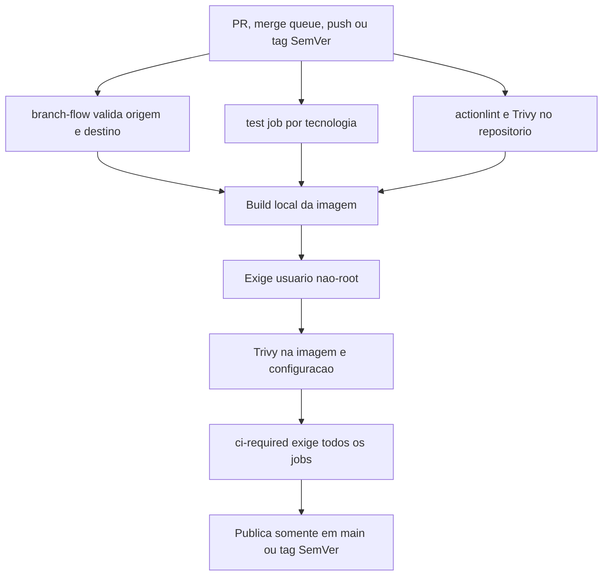
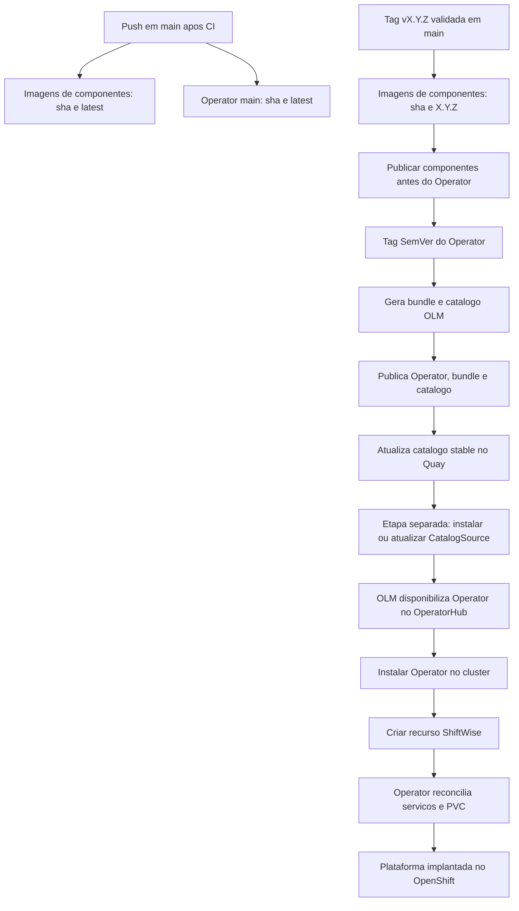

# CI/CD Implementado

Mapa do processo observado nos repositórios locais em 19/10/2026. Os workflows validam e publicam imagens; o deploy no OpenShift é uma etapa separada, feita por OLM/Operator ou pelos scripts e charts de cada serviço.

## CI por repositório

<!-- mermaid-checked: no \n, no em-dash/en-dash, no {} in labels, subgraphs are id["label"], arrows are -->|"label"|, all subgraphs closed by end, ids unique -->

Todos os sete repositórios executam o workflow `publish-quay.yml` em PRs para `main`, `stage` e `develop`, em `merge_group`, e em pushes nessas branches ou em tags `v*.*.*`. O job de build cria e escaneia a imagem também em PR; a publicação no Quay só ocorre em push para `main` ou em tag SemVer válida apontada para um commit de `main`. Pushes para `develop` e `stage` validam, mas não publicam imagem.

O fluxo de branches esperado é `feature/*` para `develop`, `develop` para `stage`, `stage` para `main`; `hotfix/*` pode abrir PR para `main` ou `develop`. `ci-required` falha se qualquer job obrigatório falhar.

| Repositório | Validação principal do job `test` |
| --- | --- |
| `kubeoptix-core-ai` | Python 3.12, instalação `.[dev]`, `pytest tests` |
| `kubeoptix-analyzer` | Python 3.12, dependências e pytest |
| `kubeoptix-harvester` | `compileall` Python e `bash -n` nos scripts |
| `kubeoptix-dashboard` | Node 24, `npm ci`, lint, testes e build |
| `kubeoptix-reporter` | Python 3.12, dependências e pytest |
| `kubeoptix-configurations` | Java 25, PostgreSQL de CI e `./mvnw verify` |
| `kubeoptix-operator` | Go da versão em `go.mod` e `go test ./...` |

O job `security` valida os workflows com actionlint e executa Trivy no repositório para vulnerabilidades e segredos HIGH/CRITICAL. Depois do build, cada imagem deve declarar usuário não-root e passa por novo scan Trivy de vulnerabilidades, segredos e, conforme configuração, misconfigurations. O workflow publica a mesma imagem local já escaneada.

## Publicação e release

<!-- mermaid-checked: no \n, no em-dash/en-dash, no {} in labels, subgraphs are id["label"], arrows are -->|"label"|, all subgraphs closed by end, ids unique -->

Nos seis componentes, push para `main` publica `sha-<commit>` e `latest`; tag `vX.Y.Z` publica `sha-<commit>` e `X.Y.Z`. O workflow do Operator em `main` publica sua imagem `sha` e `latest`, mas não gera bundle/catalog. Em tag SemVer, valida que a tag pertence a `main`, valida a ordem da release, gera o bundle e o catálogo OLM, escaneia os artefatos e publica Operator, bundle, catálogo versionado e a tag móvel `stable` do catálogo.

Para uma release versionada coerente, a documentação do Operator determina publicar primeiro as imagens de todos os componentes com a mesma versão e depois criar a tag SemVer do Operator. Essa coordenação entre repositórios é manual; não foi encontrado um workflow que dispare as releases dos componentes ou valide suas tags como dependências antes da release do Operator.

## Deploy no OpenShift

O CI/CD do GitHub não acessa o cluster nem executa deploy. O caminho de produto documentado é separado: `hack/install-catalog.sh` aplica a `CatalogSource` em `openshift-marketplace` e espera catálogo e pacote prontos; o administrador instala o Operator pelo OperatorHub e cria um recurso `ShiftWise`. O Operator então reconcilia os componentes, PostgreSQL, PVC e Route do Dashboard. A `CatalogSource` usa a tag `stable` e consulta atualizações; a aplicação/atualização da CatalogSource continua sendo uma ação operacional separada.

Há também um caminho manual/de desenvolvimento por Helm: charts de componentes definem `BuildConfig` e `ImageStream`, e scripts `install.sh` executam `helm upgrade --install` e `oc start-build`. Isso pode construir a partir do Git no cluster em vez de consumir a imagem publicada no Quay; não é uma etapa encadeada pelos workflows GitHub Actions.

## Oportunidades para simplificar

1. **Extrair um workflow reutilizável para componentes.** Os seis `publish-quay.yml` repetem branch gate, teste, actionlint, scan de fontes, build, teste de usuário, scan de imagem e publicação. Um workflow chamado com parâmetros de linguagem, comando de teste, imagem e exceção VEX reduziria drift; o Operator deve continuar separado por gerar artefatos OLM.
2. **Tornar releases coordenadas.** Hoje a ordem “componentes primeiro, Operator depois” depende de execução humana e tags compatíveis. Um checklist automatizado ou workflow de release central pode validar que todas as imagens versionadas existem antes de gerar/publicar o catálogo.
3. **Escolher um caminho principal de deploy.** OLM/Operator e instalação por Helm com BuildConfigs são dois caminhos operacionais distintos. Definir um caminho suportado como padrão reduz documentação, scripts e variação sobre onde as imagens são construídas.
4. **Separar publicação de promoção.** `latest` é atualizado no push de `main`, enquanto a instalação OLM usa `stable` no catálogo e releases imutáveis usam SemVer. Uma política explícita de promoção por ambiente evitaria tratar `latest` como release validada.
5. **Adicionar validação integrada antes da release.** As verificações são por repositório; não foi encontrado um gate único que teste em conjunto os charts/Operator e as imagens dos sete componentes.

Estas são propostas para discussão, não mudanças aplicadas ao pipeline.